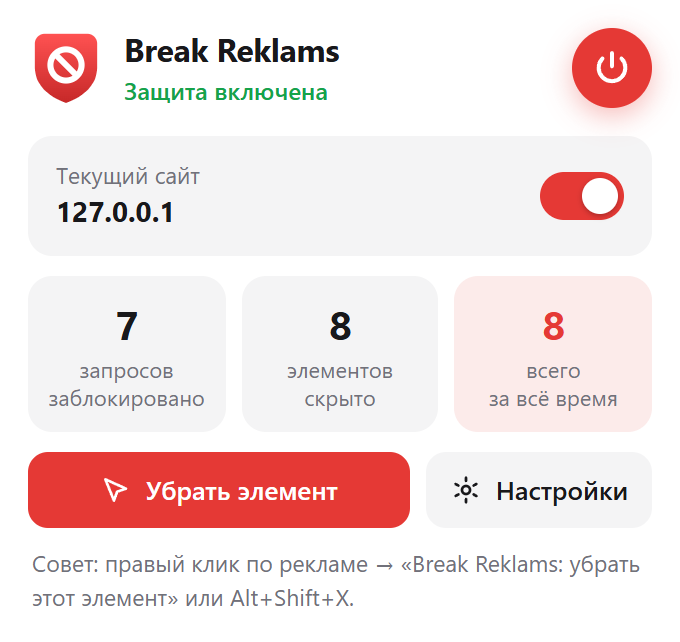
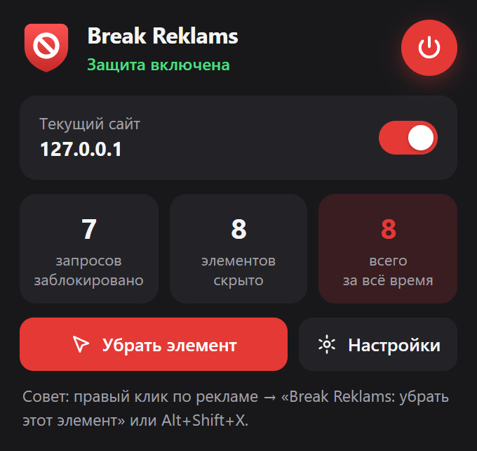
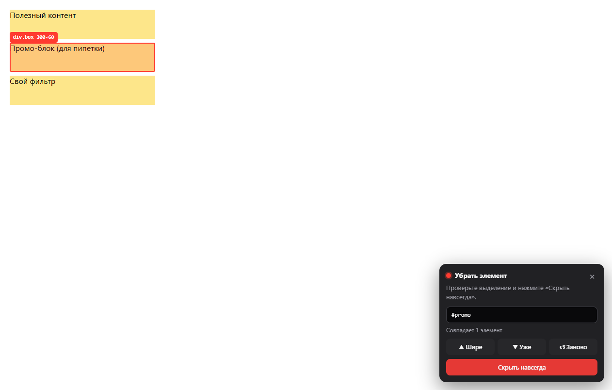

# Break Reklams — блокировщик рекламы

[](https://github.com/tgKishikaisei/break-reklams/actions/workflows/ci.yml)
[](LICENSE)

Расширение для **Chrome, Edge, Яндекс.Браузера, Opera, Brave** и других браузеров на Chromium, а также для **Firefox** (Manifest V3). Для браузеров без поддержки расширений (DuckDuckGo) есть hosts-файл.

> **English:** Break Reklams is a Manifest V3 ad blocker for Chromium browsers (experimental Firefox build included). It combines network blocking, cosmetic filtering, a generic VAST/VMAP interceptor that removes video ads from embedded players on any domain, YouTube ad removal, anti-adblock countermeasures and uBlock Origin–style scriptlets. Documentation is in Russian.

<p align="center">
  
  &nbsp;
  
</p>
<p align="center">
  
</p>

## Что умеет

| | |
|---|---|
| **Сетевая блокировка** | Запросы к рекламным сетям и трекерам режутся движком браузера (`declarativeNetRequest`). Это быстро и почти не расходует память. |
| **Скрытие элементов** | Прячет рекламные блоки: AdSense, Google Publisher Tag, Яндекс РСЯ/AdFox, Taboola, Outbrain, MGID и т. д. CSS внедряется как «пользовательский», поэтому сайт не может его перебить. Общие селекторы подгружаются лениво, только для классов, которые реально есть на странице. |
| **Видеоплееры на сайтах** | Kodik, Alloha, Collaps и другие плееры берут рекламные ролики по стандарту VAST. Расширение перехватывает эти ответы в любом плеере и на любом домене, и плеер сразу получает «рекламы нет». Благодаря этому реклама режется, даже когда рекламная сеть сменила домен. |
| **YouTube** | Вырезает рекламу из ответа плеера до того, как её увидит YouTube. Если реклама всё-таки прорвалась, глушит звук, проматывает ролик и жмёт «Пропустить». Убирает окно «Блокировщики рекламы запрещены». |
| **Всплывающие окна** | Закрывает рекламные вкладки (поп-андеры), блокирует `window.open` на рекламные сети и из-за кликов по невидимым слоям. |
| **Анти-антиблок** | Убирает окна «Отключите AdBlock», возвращает прокрутку и снимает размытие. Подменяет скрипты-детекторы (FuckAdBlock, BlockAdBlock) заглушками. |
| **Заглушки** | Вместо `adsbygoogle.js`, `gpt.js`, `gtm.js`, `analytics.js` сайт получает безобидные заглушки, чтобы код сайта не падал без рекламы и аналитики. |
| **Пипетка** | Правый клик по рекламе → «Break Reklams: убрать этот элемент» (или `Alt+Shift+X`, или кнопка в окне расширения). Правило сохраняется навсегда. |
| **Исключения** | Выключатель «Блокировать на этом сайте» в окне расширения. |
| **Мои фильтры** | Свои правила в синтаксисе Adblock Plus / uBlock Origin. Строки из hosts-файлов тоже принимаются. |
| **Cookie-баннеры** | По желанию (выключено по умолчанию). |

Всё работает локально: расширение ничего никуда не отправляет.

## Установка

### Скачать

- **Готовые архивы** — на странице [Releases](../../releases): `break-reklams-chrome.zip`, `break-reklams-firefox.zip`, `break-reklams-hosts.zip`. Распакуйте нужный архив в папку, которую не будете удалять.
- **Или исходники:** кнопка **Code → Download ZIP** (папка расширения внутри — `extension`) либо `git clone`.

### Chrome, Edge, Яндекс.Браузер, Opera, Brave

1. Откройте страницу расширений:

   | Браузер | Адрес |
   |---|---|
   | Chrome | `chrome://extensions` |
   | Edge | `edge://extensions` |
   | Яндекс.Браузер | `browser://extensions` |
   | Opera | `opera://extensions` |
   | Brave | `brave://extensions` |

2. Включите **«Режим разработчика»**.
3. Нажмите **«Загрузить распакованное расширение»** и выберите папку с расширением (`extension` из исходников или распакованный `break-reklams-chrome.zip`).
4. Закрепите значок Break Reklams на панели: значок пазла → булавка.

Папку после установки не удаляйте и не переносите: браузер загружает расширение прямо из неё. После обновления нажмите ↻ у расширения на странице расширений.

### Firefox (экспериментально)

Нужен Firefox 128 или новее. Версия для Firefox собирается из того же кода; автоматического теста в самом Firefox пока нет — если что-то не работает, [напишите](../../issues/new/choose).

- **До перезапуска браузера:** откройте `about:debugging#/runtime/this-firefox` → «Загрузить временное дополнение…» → выберите `manifest.json` из распакованного `break-reklams-firefox.zip` (или из `dist/firefox` после `npm run package`).
- **Навсегда:** обычный Firefox ставит только расширения, подписанные Mozilla. Подпись бесплатная: на [addons.mozilla.org/developers](https://addons.mozilla.org/developers/) выберите «Submit a New Add-on» → «On your own», загрузите `break-reklams-firefox.zip` и через несколько минут скачайте подписанный `.xpi`.

Если Firefox попросит, разрешите доступ ко всем сайтам: без него работает только блокировка запросов. Кнопка «Разрешить» есть в окне расширения и в настройках.

### DuckDuckGo и другие браузеры без расширений

DuckDuckGo не поддерживает расширения. Для него (и для всех браузеров и программ на компьютере) есть hosts-файл: распакуйте `break-reklams-hosts.zip` (или выполните `npm run hosts` — файлы появятся в `dist/hosts`), дважды щёлкните `install-hosts.cmd` и подтвердите запрос прав администратора. Перезапустите браузер. Удалить — `uninstall-hosts.cmd`. Ваши записи в hosts не трогаются, резервная копия сохраняется рядом (`hosts.break-reklams.bak`).

Проверить: `ping pagead2.googlesyndication.com` должен ответить «не удалось обнаружить узел».

hosts грубее расширения: он блокирует только перечисленные домены (без поддоменов и масок), не прячет рекламные блоки и не справляется с рекламой в плеерах, у которой меняются домены. Для более сильной защиты можно включить в Windows DNS с блокировкой рекламы: «Параметры» → «Сеть и Интернет» → подключение → «Назначение DNS-сервера» → «Вручную», например AdGuard DNS `94.140.14.14` и `94.140.15.15`, шифрование «Только зашифрованный (DNS через HTTPS)».

## Если сайт пытается заметить блокировщик

| Как сайт проверяет | Что делает Break Reklams |
|---|---|
| Грузит рекламный скрипт, картинку или `fetch` и ждёт ошибку | Запросы к рекламным доменам не падают с ошибкой, а получают пустой успешный ответ (пустой скрипт, картинку 1×1, пустой текст) |
| Создаёт невидимую «приманку» с рекламным классом и меряет её высоту | Приманки за краем экрана не прячутся: высота остаётся ненулевой |
| Проверяет `window.adsbygoogle`, `googletag`, FuckAdBlock/BlockAdBlock | Подставляет заглушки, которые отвечают «реклама на месте» |
| Ищет следы расширения на странице | Меток в `window` нет, подменённые функции выглядят родными (`[native code]`), CSS скрытия не виден в `document.styleSheets` |
| Детектор, написанный специально под конкретный сайт | Скриптлеты (`##+js(...)`) из списков фильтров. После `npm run update` подключаются тысячи готовых решений из AdGuard Russian и других списков |
| Всё равно показал окно «отключите AdBlock» | Окно удаляется, прокрутка и чёткость страницы возвращаются |

Если сайт совсем не работает с блокировщиком, отключите защиту для него переключателем в окне расширения.

## Максимальная защита: большие списки фильтров

Встроенные списки покрывают самые распространённые рекламные сети. Чтобы подключить EasyList, EasyPrivacy, AdGuard Russian, RU AdList, список Peter Lowe и EasyList Cookie (десятки тысяч правил), нужен [Node.js](https://nodejs.org) 20 или новее:

```bash
npm run update
```

Команда скачает списки в `filters/external/` и пересоберёт правила. После этого нажмите ↻ у расширения на странице расширений. Запускайте раз в пару недель, чтобы списки оставались свежими.

Внешние списки в репозиторий не входят и распространяются под своими лицензиями (EasyList и EasyPrivacy — GPLv3 / CC BY-SA 3.0, AdGuard — GPLv3 и т. д.).

## Нашли рекламу или сломанный сайт?

Откройте [issue](../../issues/new/choose) по шаблону «Реклама не заблокирована» или «Сайт сломался» — укажите адрес страницы и браузер.

## Для разработчиков

```
extension/            ← папка расширения (её и загружать в браузер)
  background.js       фон: наборы правил, исключения, CSS, скриптлеты, статистика
  lib/abp.js          парсер фильтров ABP/uBO → правила declarativeNetRequest, косметика, скриптлеты
  lib/cosmetic.js     подбор CSS-селекторов для сайта
  lib/scriptlets.js   реализация скриптлетов (set-constant, json-prune, no-fetch-if, …)
  content/            скрипты страниц: косметика, VAST, YouTube, защита от поп-апов, пипетка
  resources/          заглушки для $redirect
  rules/, data/,      результат сборки (npm run build) — хранится в репозитории,
  generated/          чтобы расширение можно было загрузить сразу после клонирования
filters/              исходные списки фильтров + lists.json (источники и лимиты правил)
tools/                сборка правил, загрузка списков, упаковка, hosts, проверка текста
test/                 unit-тесты парсера и сквозной тест в настоящем Chrome
```

| Команда | Что делает |
|---|---|
| `npm run build` | пересобрать правила из `filters/` |
| `npm run update` | скачать внешние списки и пересобрать |
| `npm test` | unit-тесты парсера фильтров |
| `npm run lint:text` | найти невидимые символы, нестандартные пробелы, пробелы в конце строк и CRLF (`-- --fix` — исправить) |
| `npm run check` | `lint:text` + unit-тесты |
| `npm run e2e` | сквозной тест: headless Chrome + расширение + тестовые страницы (нужен openssl, он есть в Git for Windows) |
| `npm run package` | собрать `dist/firefox` и zip-архивы для Chrome и Firefox |
| `npm run hosts` | собрать hosts-файл и скрипты установки в `dist/hosts` |
| `npm run icons` | перерисовать иконки |

Зависимостей нет: достаточно Node.js 20+. На каждый push GitHub Actions запускает проверку текста, unit-тесты, проверку того, что собранные правила совпадают с `filters/`, и сквозной тест в Chrome. Тег `v*` (например, `git tag v1.0.1 && git push --tags`) собирает архивы и публикует релиз.

Свои правила для всех пользователей сборки можно дописывать в `filters/ads.txt`, `filters/trackers.txt` и `filters/annoyances.txt`, затем выполнить `npm run build` и закоммитить результат.

### Ограничения Manifest V3

- Chrome гарантирует расширению 30 000 статических правил. Бюджет по категориям задан в `filters/lists.json`, и сборщик сжимает правила вида `||domain^` в одно правило со списком доменов.
- Регулярные выражения и процедурные фильтры (`:has-text()` и т. п.) из внешних списков пропускаются.
- Поддерживаются 22 самых распространённых скриптлета uBlock Origin и AdGuard: `set-constant`, `abort-on-property-read`, `abort-current-script`, `no-setTimeout-if`, `json-prune`, `no-fetch-if`, `remove-attr` и другие. Скриптлеты `trusted-*` не поддерживаются. Скриптлеты из «Моих фильтров» внедряются очень рано, но без гарантии опередить все скрипты сайта; скриптлеты из встроенных списков всегда срабатывают раньше.

## Лицензия

[MIT](LICENSE)
